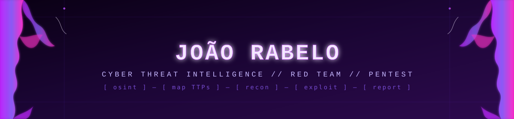

<div align="center">



[](https://github.com/rabelojp41)
[](https://www.linkedin.com/in/joao-rabelo-a30b56257/)
[](mailto:jprabelo41@gmail.com)

</div>

---

Ooooi 👋 eu sou o **Rabelo**, da área de cyber! Curto muito **JJK** e **Hunter x Hunter**, e sou apaixonado por **roxo**: é a cor que atravessa os meus designs e boa parte das minhas inspirações (dá pra perceber por aqui).

### `whoami`

Assistente Jr. de Red Team na **AuditSafe** e estudante de **Defesa Cibernética** na FIAP. Meu foco agora é **Cyber Threat Intelligence**: uso OSINT no reconhecimento dos pentests, mapeio TTPs no MITRE ATT&CK e faço engenharia reversa de malware pra entender quem ataca, como e por quê. Tudo isso sem largar o red team e o PCI DSS do dia a dia.

```
> foco atual:   Cyber Threat Intelligence · Pentest (PTES) · PCI DSS v4.0.1
> estudando:    análise de malware, threat research, emulação de adversários
> stack diária: Maltego · MITRE ATT&CK · Ghidra · FLOSS · YARA · Burp Suite · Nessus
```

<div align="center">

| 🕵️ **CTI & OSINT** | 🎯 **Red Team** | 🛡️ **PCI DSS** |
|:---:|:---:|:---:|
| OSINT com Maltego, mapeamento de TTPs no MITRE ATT&CK, engenharia reversa com Ghidra e FLOSS, regras YARA, Sigma e Snort. | Pentest interno/externo seguindo PTES, reconhecimento ativo e passivo, exploração e testes de aplicações web/API. | Avaliações PCI DSS v4.0.1, mapeamento de controles, coleta de evidências e testes de segmentação em AWS e Azure. |

</div>

---

### `stack.json`

<div align="center">

**Threat Intelligence & OSINT**


**Detecção & Regras**


**Malware & Engenharia Reversa**


**Ofensiva & Pentest**


**Compliance & Scanning**


**Dev & Automação**


</div>

---

### `certifications // education`

- 🎓 **Defesa Cibernética** — FIAP (em andamento)
- 📜 **ISC2 Certified in Cybersecurity (CC)**
- 📜 **CompTIA Security+** (em andamento)
- 📜 **SYCP** — Solyd One (em andamento)
- 📜 **Pentester na Era da IA** — IBSEC
- 📜 **Red Hat RH124** — Red Hat System Administration I
- 📜 **Red Hat RH134** — Red Hat System Administration II

---

### `projects // no momento`

- 🧬 **[RabMapper](https://github.com/rabelojp41/RabMapper)** — framework de CTI em Python: extrai IOCs com FLOSS, reverte ofuscação, mapeia técnicas no MITRE ATT&CK e na Kill Chain, gera regras YARA validadas contra a amostra e exporta indicadores em STIX 2.1 e MISP. Tem resumo por IA local, conferido contra os achados.
- 🦠 **Backdoor.Win32.Tyupkin** — relatório de CTI sobre malware de jackpotting em ATMs: análise estática e dinâmica, engenharia reversa no Ghidra, regras YARA, Sigma e Snort e TTPs mapeadas no ATT&CK
- ⛓️ **IcedID → Cobalt Strike → Nokoyawa** — kill chain de ransomware mapeada no ATT&CK Navigator, com regras YARA pra classificação
- 🔍 Pentests e avaliações PCI DSS v4.0.1 para múltiplos clientes na AuditSafe, com OSINT no reconhecimento
- 🕹️ **OBL1VION** — RPG de conscientização em cibersegurança em Unity, estilo Pokémon FireRed, desenvolvido para a Leroy Merlin

---

<div align="center">

```
[ osint ] — [ recon ] — [ exploit ] — [ emulate APT ] — [ map TTPs ] — [ report ]
```

<sub>construído em ambiente isolado · aprendendo em público</sub>

</div>
