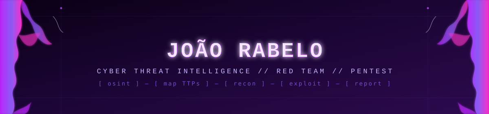

<div align="center">



[](https://github.com/rabelojp41)
[](https://www.linkedin.com/in/joao-rabelo-a30b56257/)
[](mailto:jprabelo41@gmail.com)

</div>

---

Ooooi 👋 eu sou o **Rabelo**, da área de cyber! Curto muito **JJK** e **Hunter x Hunter**, e sou apaixonado por **roxo**: é a cor que atravessa os meus designs e boa parte das minhas inspirações (dá pra perceber por aqui).

### `whoami`

Analista de Segurança Pleno (Pentest) na **Stefanini Cyber** e tecnólogo em **Defesa Cibernética** pela FIAP. Trabalho na interseção entre **Cyber Threat Intelligence**, **Red Team** e **Pentest**: estudo quem ataca e como (TTPs, malware, campanhas) e uso isso pra atacar melhor, do reconhecimento OSINT ao relatório. Hoje conduzo pentests Black, Gray e White Box em aplicações web, APIs e infraestrutura pra clientes; antes, na AuditSafe, fazia pentest interno/externo e avaliações **PCI DSS v4.0.1**.

```
> foco atual:   Pentest Web · API · Infra · Red Team · Cyber Threat Intelligence · Active Directory
> estudando:    pentest mobile (Android), pentest wireless (Wi-Fi), análise de malware, emulação de adversários
> stack diária: Burp Suite Pro · Nmap · MITRE ATT&CK · Maltego · Ghidra · FLOSS · YARA
```

<div align="center">

| 🕵️ **Cyber Threat Intelligence** | 🩸 **Red Team** | 🎯 **Pentest** |
|:---:|:---:|:---:|
| OSINT com Maltego, perfil de threat actors, mapeamento de TTPs no MITRE ATT&CK e na Kill Chain, engenharia reversa com Ghidra e FLOSS, enriquecimento de IOCs (VirusTotal, Shodan, MISP, OpenCTI) e regras YARA, Sigma e Snort. | Pensar como o adversário: reconhecimento passivo e ativo, ataques a Active Directory e SMB, escalada de privilégio em Windows e Linux e estudo de emulação de APTs a partir de CTI. | Pentest interno e externo seguindo PTES, testes web/API (OWASP Top 10), varreduras credenciadas, validação de falsos positivos, priorização por CVSS e relatório técnico com remediação. |

</div>

---

### `experience.log`

**🟣 Analista de Segurança Pleno (Pentest) — Stefanini Cyber** · `11/2026 → atual`
- Pentests Black Box, Gray Box e White Box pra clientes da consultoria, cobrindo aplicações web, APIs e infraestrutura (interna e externa), do reconhecimento ao reteste
- Testes autenticados e não autenticados com Burp Suite Pro, incluindo aplicações com SSO (SAML): contorno de WAF por origem exposta, ausência de limite de tentativas no login, enumeração de usuários, cookies inseguros
- Relatórios Técnico e Executivo seguindo OSSTMM, PTES, OWASP e NIST SP 800-115, com CVSS, OWASP Risk Rating e mapeamento MITRE ATT&CK

**🟣 Assistente Jr. de Red Team — AuditSafe** · `01/2026 → 11/2026`
- Pentest interno e externo (PTES) em Windows e Linux: OSINT com Maltego, enumeração e exploração controlada com Nmap, Burp Suite e Metasploit
- Testes web e de APIs com Burp Suite e OWASP ZAP, baseados no OWASP Top 10
- Varreduras credenciadas com Nessus (SMB/WMI, SSH) e Outpost24; triagem de findings, separação de falsos positivos e priorização por CVSS
- Validação de falsos positivos em scans ASV (bypass por CDN, cadeia SSL, flags de cookie, CORS)
- PCI DSS v4.0.1: segmentation testing entre o CDE e demais zonas em AWS (Security Groups, NACLs) e Azure (NSGs), com parecer PASS/FAIL/OBS
- Apoio em investigação de incidentes e análise de malware
- Automação em Python de relatórios, apresentações e certificados de treinamento

---

### `projects // threat intel`

- 🧬 **[Nutshell Mapper](https://github.com/rabelojp41/NutShell-Mapper)** — framework de CTI em Python (18 módulos, ~8.000 linhas, 370 testes): extrai strings e IOCs com FLOSS, reverte ofuscação (Base64/XOR/hex), mapeia 40 técnicas do MITRE ATT&CK e a Kill Chain, sugere atribuição de grupo, enriquece via VirusTotal e Shodan, gera regras YARA validadas contra a amostra e exporta em STIX 2.1 e MISP. Tem resumo por IA local, conferido contra os achados.
- 🦠 **Backdoor.Win32.Tyupkin** — relatório de CTI sobre malware de jackpotting em ATMs: análise estática e dinâmica, engenharia reversa no Ghidra, regras YARA, Sigma e Snort e TTPs mapeadas no ATT&CK
- ⛓️ **IcedID → Cobalt Strike → Nokoyawa** — kill chain de ransomware mapeada no ATT&CK Navigator, com regras YARA pra classificação
- 🇰🇵 **Kimsuky** — investigação de threat actor no Maltego (FIAP, em grupo): campanhas, vítimas e setores-alvo, técnicas, malware e ferramentas mapeados no ATT&CK

### `projects // red team & pentest`

- 💀 **Labs black-box documentados** (relatório, remediação e mapeamento ATT&CK):
  - **HidricaNova** — Nmap → FTP anônimo → OSINT interno → credential stuffing com Hydra → sudo/GTFOBins → root, com containers vulneráveis descobertos
  - **Tempest** — SQL Injection em MariaDB, sqlmap e quebra de hashes SHA-256 com John the Ripper
  - **Constant** — FTP anônimo, reuso de senha e sudo irrestrito
- 🏰 **Active Directory** — TryHackMe Intro to AD Breaching, ataques AD/SMB com NetExec e Evil-WinRM
- 🪜 **Privesc Windows** — WinPEAS, PowerUp, SharpUp e PrintSpoofer
- 🌐 **Web exploitation** — SQL Injection, Command Injection e SSTI em laboratório
- 📚 **Base de conhecimento de vulnerabilidades** (Notion + GitHub) com scripts Python de validação: TLS 1.0/1.1, BEAST, CORS, clickjacking, flags de cookie, open redirect, source maps, cadeia SSL e bypass por porta de origem TCP/UDP
- 📱 **Pentest mobile (Android)** — lab próprio com emulador Android 13 com root integrado ao Kali via ADB; análise estática de APKs com jadx e Apktool (manifest, componentes exportados, detecção de root/anti-debug); desafios OWASP MASTG UnCrackable e Hacker101 em andamento
- 🥈 **[CTF FIAP NEXT 2026](https://github.com/rabelojp41/NextFiap-CTF)** — 2º lugar com a equipe; scripts e guia publicados
- 🎮 TryHackMe e Hack The Box (Cap, Facts)

### `projects // outros`

- 🕹️ **OBL1VION** — jogo de conscientização em cibersegurança desenvolvido para a Leroy Merlin: roteiros, direção de arte e documentação técnica

---

### `stack.json`

<div align="center">

**Threat Intelligence & OSINT**


**Malware & Engenharia Reversa**


**Detecção & Regras**


**Red Team & Pentest**


**Mobile (Android)**


**Scanning & Compliance**


**Ambientes**


**Dev & Automação**


</div>

---

### `certifications // education`

- 🎓 **Tecnólogo em Defesa Cibernética** — FIAP (concluído em 2026)
- 📜 **CompTIA Security+ (SY0-701)** (nov/2026)
- 📜 **ISC2 Certified in Cybersecurity (CC)**
- 📜 **FIAP Certified Penetration Testing Professional** (jun/2026)
- 📜 **FIAP Certified Information Security Officer** (dez/2025)
- 📜 **Pentester na Era da IA** — IBSEC
- 📜 **Red Hat RH124 / RH134** — System Administration I e II
- 📜 **Inglês C1** — EF SET
- ⏳ **SYCP** — Solyd One (em andamento)

---

<div align="center">

```
[ osint ] — [ profile actor ] — [ map TTPs ] — [ recon ] — [ exploit ] — [ emulate ] — [ report ]
```

<sub>construído em ambiente isolado · aprendendo em público</sub>

</div>
